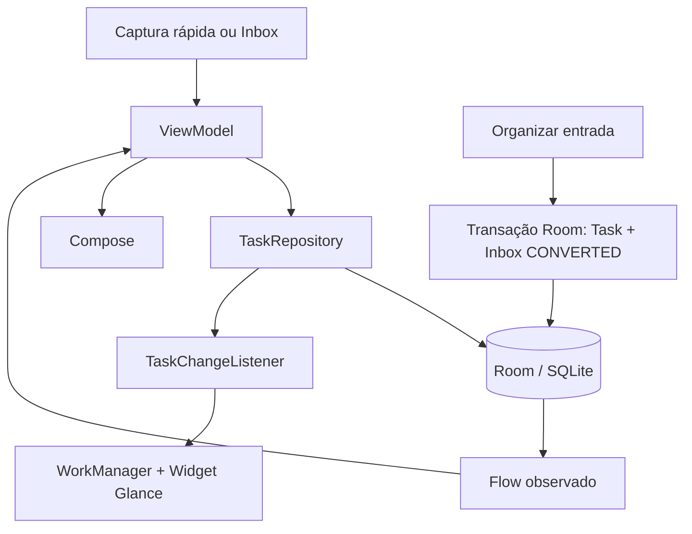

# Arquitetura — offline-first

## Limites

- **UI** (`ui/`): Compose renderiza `PulsoUiState`, ViewModel coordena ações e converte erros para callbacks.
- **Domínio** (`domain/`): contratos puros `InboxItem`, `TaskItem`, `TaskDraft`, `TaskRules`.
- **Persistência** (`data/`): Room v2 (migração explícita 1→2) e `TaskRepository`, que publica `Flow<List<...>>`. Room é a única fonte de verdade.
- **Widget** (`widget/`): consulta `repository.observeTasks().first()` e mostra até três tarefas; usa callback no repositório para concluir.
- **Lembretes** (`reminders/`): `TaskChangeListener.taskChanged(taskId, reminderAt)` agenda/cancela WorkManager (`reminderAt` = adiamento ou prazo; `null` cancela) e atualiza o widget. O worker reconfere o horário antes de notificar. `ReminderActionReceiver` trata Concluir/Adiar da notificação.
- **Preferências**: DataStore para tema (Sistema/Claro/Escuro + cores do sistema), horário padrão do prazo, data da última revisão e se o pedido de notificação já foi exibido.
- **Backup**: `BackupService` (formato v2, lê v1) valida tudo antes de escrever e importa aditivamente numa única transação Room; sem sobrescrita por UUID.

## Fluxos principais

## Modelo de dados local v2

**InboxEntity:** `id` UUID, `text`, `status=INBOX|CONVERTED|ARCHIVED`, `createdAt`, `updatedAt`, `convertedTaskId`, `deletedAt`. Converter preserva entrada original e referência da tarefa.

**TaskEntity:** `id` UUID, `title`, `notes`, `category` (texto), `priority=LOW|NORMAL|HIGH`, `dueAt?`, `completedAt?`, `createdAt`, `updatedAt`, `deletedAt?`. Exclusão é lógica; reativação de tarefa concluída limpa `completedAt`. v2: `links` (texto, um por linha) e `snoozedUntil` (adia só o lembrete).

**CategoryEntity (v2):** `id`, `name`, timestamps, `deletedAt`. Tarefas guardam o *nome* da categoria; renomear atualiza tarefas na mesma transação.

**RescheduleEntity (v2):** histórico append-only `taskId`, `fromDueAt`, `toDueAt`, `changedAt`, indexado por `taskId`.

Datas persistidas em epoch milliseconds UTC; UI converte para fuso local. Prazo = data + hora escolhidas no fuso local (hora padrão configurável, 09:00 por omissão). `dueAt` é instante; **não** equivale a data sem hora.

## Extensibilidade para nuvem

Room continua SSOT, nunca leitura direta da rede para tela. Em V2 adicionar `RemoteDataSource` + `SyncCoordinator` + outbox persistente, paginação, idempotência, versionamento servidor e tombstones. Não usar somente `updatedAt` como resolução de conflitos. Autenticação e migração de registros anônimos precisarão de design específico. A API ASP.NET Core e UI desktop são projetos futuros separados. Ver [ADR 0003](adr/0003-sync-future.md).

## Fronteiras intencionais

- Uma única feature não justifica multi-modularização/DDD/CQRS/MediatR no cliente.
- `TaskChangeListener` é uma porta; o listener Android implementa integração de widgets/notificações.
- Não adicionar `allowMainThreadQueries`, `fallbackToDestructiveMigration` ou `GlobalScope`.
- Mudança de banco exige migração e preservação de dados existentes.

## Pontos a reforçar

Schemas exportados em `app/schemas` (v1 e v2) são versionados e alimentam `MigrationTestHelper`. Importação reagenda lembretes das tarefas novas. Widget ainda sem teste automatizado. Specs e MEMORY especificam status real.
