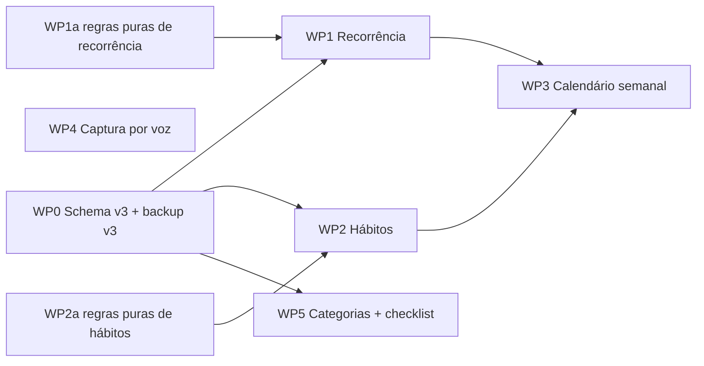

# Plano de implementação — M1.5 Rotinas

**Status:** WP0, WP1, WP2, WP3 (unitários; validação manual pendente) e WP4 implementados; WP5 planejado (ver [ROADMAP](ROADMAP.md) e `MEMORY.md`). Documentação base criada em 2026-11-19.

Este documento divide o M1.5 do [ROADMAP](ROADMAP.md) em pacotes de trabalho (WP) que agentes diferentes podem executar com pouco conflito. Leia antes o `AGENTS.md` raiz; as regras dele valem para todos os pacotes.

## 1. Escopo do M1.5 (do ROADMAP para specs)

| Item do ROADMAP | Spec | ADR |
|---|---|---|
| Tarefas recorrentes | [SPEC 008](specs/008-tarefas-recorrentes.md) | [0005](adr/0005-recorrencia-por-ocorrencias.md) |
| Hábitos | [SPEC 009](specs/009-habitos.md) | [0006](adr/0006-habitos-separados.md) |
| Calendário semanal | [SPEC 010](specs/010-calendario-semanal.md) | — |
| Captura por voz | [SPEC 011](specs/011-captura-por-voz.md) | [0007](adr/0007-voz-pelo-reconhecedor-do-sistema.md) |
| Importação/exportação versionada e migrações | [SPEC 012](specs/012-schema-v3-backup-e-migracoes.md) | [0008](adr/0008-schema-v3-consolidado.md) |
| Organização por compras, estudos, manutenção, casamento, encomendas | [SPEC 013](specs/013-visoes-por-categoria-e-checklist.md) | — |

## 2. Decisões confirmadas pelo dono do produto (2026-11-19)

Todas aceitas; ADRs 0005–0008 em **Aceita**. O WP0 pode começar. Depois do merge do WP0 o schema v3 fica congelado: mudar qualquer item abaixo que afete dados exige v4.

1. **Checklist dentro da tarefa (SPEC 013)** entra no M1.5; `checklist_items` faz parte do WP0.
2. **Hábitos como entidade separada** (ADR 0006) em vez de "tarefa recorrente diária".
3. **Navegação:** nova aba "Semana" (5 abas: Hoje, Entrada, Tarefas, Semana, Ajustes). Hábitos aparecem em Hoje e na Semana; o gerenciamento fica em uma sobreposição "Hábitos" aberta por Hoje e por Ajustes.
4. **Voz:** usar o reconhecedor do Android (pode usar rede conforme o provedor do aparelho), com aviso de privacidade (ADR 0007).
5. **Lembretes de hábitos:** ficam como P2 (opcional) no M1.5.

## 3. Pacotes de trabalho e dependências

| WP | Entrega | Depende de | Pode rodar em paralelo com |
|---|---|---|---|
| **WP0** | Entidades, DAOs, `Migration2To3`, schema `3.json`, backup v3, testes de migração e backup (SPEC 012) | nada (decisões confirmadas) | WP1a, WP2a, WP4 |
| **WP1a** | `RecurrenceRules` puro + testes unitários (SPEC 008 §Regras) | nada | WP0, WP2a, WP4 |
| **WP2a** | `HabitRules` puro + testes unitários (SPEC 009 §Regras) | nada | WP0, WP1a, WP4 |
| **WP1** | Repositório + editor + rótulos de recorrência | WP0, WP1a | WP4; WP2 só se não tocarem os mesmos arquivos ao mesmo tempo (ver §4) |
| **WP2** | Repositório + UI de hábitos (Hoje + sobreposição Hábitos) | WP0, WP2a | WP4 |
| **WP3** | Aba Semana (SPEC 010) | WP1 e WP2 (projeções e linha de hábitos); a grade só de tarefas pode começar após WP0 | WP4, WP5 |
| **WP4** | Captura por voz (SPEC 011) | nada (não toca o banco) | todos |
| **WP5** | Tela por categoria, checklist, sugestões de categoria (SPEC 013) | WP0 | WP3, WP4 |

Ordem sugerida para um agente só: WP0 → WP1a → WP1 → WP2a → WP2 → WP3 → WP5, com WP4 em qualquer momento.

## 4. Arquivos de alto conflito

Dois agentes não devem editar estes arquivos ao mesmo tempo. Quem pegar um WP que os toca deve anunciar no PR/issue e fazer rebase antes de abrir o PR.

| Arquivo | Tocado por |
|---|---|
| `data/PulsoDatabase.kt`, `data/Entities.kt`, `app/schemas/` | **somente WP0** (depois do WP0 só leitura, salvo novas queries DAO) |
| `data/BackupService.kt` | **somente WP0** |
| `data/TaskRepository.kt` | WP1, WP2 (preferir `HabitRepository` separado, ver SPEC 009), WP5 |
| `domain/Models.kt` | WP0 (tipos), WP1/WP2 não devem redefinir os tipos do WP0 |
| `ui/PulsoViewModel.kt` | WP1, WP2, WP3, WP5 |
| `ui/PulsoScreens.kt` (abas, sobreposições, Hoje) | WP2, WP3, WP5 |
| `ui/TaskComponents.kt` (`TaskEditorDialog`, `TaskCard`) | WP1, WP5 |
| `CaptureActivity.kt`, `AndroidManifest.xml`, `res/xml/shortcuts.xml` | WP4 |
| `widget/TodayWidget.kt` | WP4 (botão de voz, opcional) |

Para reduzir conflitos: código novo em arquivos novos (`domain/RecurrenceRules.kt`, `domain/HabitRules.kt`, `data/HabitRepository.kt`, `ui/WeekScreen.kt`, `ui/HabitScreens.kt`, `ui/VoiceCapture.kt`, `ui/CategoryScreen.kt`); nos arquivos compartilhados, só o mínimo para ligar a feature.

## 5. Regras comuns a todos os WPs

- Seguir `AGENTS.md` §1 (invariantes) e §5 (DoD). Gates: `gradlew.bat :app:testDebugUnitTest :app:lintDebug :app:assembleDebug` (JBR 21, ver `MEMORY.md`). Instrumentados via `am instrument` quando tocar `data/`.
- Regras de data/recorrência/sequência são **puras** em `domain/` e testadas em `app/src/test/` com `ZoneId` fixo (`America/Sao_Paulo`) e um fuso com horário de verão (`Europe/Lisbon` ou `America/New_York`).
- Toda escrita nova passa pelo repositório; operações com mais de uma linha usam `withTransaction`.
- Toda entidade nova tem UUID, `createdAt`, `updatedAt`, `deletedAt` (tombstone). Nada de `DELETE` físico em dados do usuário.
- Toda mudança de tarefa continua chamando `TaskChangeListener.taskChanged` (lembrete + widget).
- Texto de UI em pt-BR; `contentDescription` em ícones e checkboxes; alvos ≥ 48dp; respeitar `docs/DESIGN.md`.
- Ao concluir um WP: marcar os aceites da spec com evidência, atualizar `ROADMAP.md` (`[~]`/`[x]`) e `MEMORY.md` (estado de validação). Não marcar "Validado no Moto G84" sem teste no aparelho.

## 6. Briefing curto para cada agente

Copie para o agente o bloco do WP:

- **WP0:** "Implemente a SPEC 012 inteira (schema v3, `Migration2To3`, backup v3, testes). Não implemente lógica de recorrência/hábitos além de entidades, DAOs, mapeamentos e tipos de domínio listados na spec. Exporte `app/schemas/.../3.json`."
- **WP1a / WP2a:** "Implemente apenas `RecurrenceRules` (SPEC 008 §Regras) / `HabitRules` (SPEC 009 §Regras) com testes unitários. Não toque `data/` nem `ui/`."
- **WP1:** "Implemente a SPEC 008 a partir do WP0 e WP1a: repositório, editor, rótulos e 'Desfazer'."
- **WP2:** "Implemente a SPEC 009 a partir do WP0 e WP2a: `HabitRepository`, seção de hábitos em Hoje, sobreposição Hábitos."
- **WP3:** "Implemente a SPEC 010 (aba Semana)."
- **WP4:** "Implemente a SPEC 011 (captura por voz). Não adicione `RECORD_AUDIO` nem `INTERNET`."
- **WP5:** "Implemente a SPEC 013 (tela por categoria, checklist, sugestões)."
